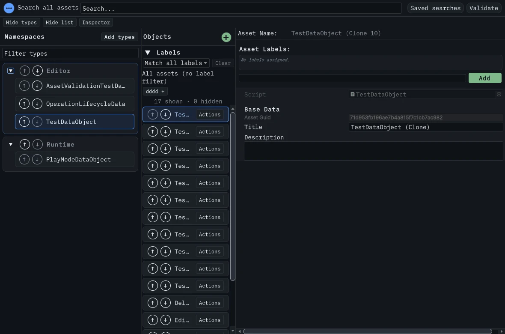

# Catalog and browsing observations, 24 October 2026

These are warm-process observations on Unity 6000.5.2f1 Windows. They do not establish Unity 2021.3 execution, other-platform performance, fresh-process behavior or a large-project
support guarantee. Source/module checks and raw emitted reports distinguish component work from actual assets.

## Catalog construction and scrolling

[Raw catalog samples](catalog-layout-2026-10-24.json) contain all 180 measured observations: five discarded warm-ups and 30 samples for each size/distribution. The experiment
passed in 280.07 seconds under its declared ten-minute limit and 512 MiB additional retained-managed-heap guard. Native editor hosts and window wrappers returned to their starting
counts.

The production `NamespaceController.Build` creates the UI in a hosted, themed 360 × 720 window. Inputs use 4,000 generated plain CLR class identities, not ScriptableObjects or
imported scripts. Half support each namespace distribution; each condition uses a prefix of 100, 1,000 or 2,000 identities. Their names and namespace keys are distinct. No Unity
assets are created or instantiated. These CLR types remain in this editor process; the report is synthetic catalog work, not asset discovery, activation, mutation or real-project
type registration.

| Types | Distribution            | Construction p95 (ms) | Observed scroll p95 (ms) | Instantiated elements | Instantiated type rows | Rows intersecting viewport | Editor-frame allocation p95 (bytes) |
| ----- | ----------------------- | --------------------- | ------------------------ | --------------------- | ---------------------- | -------------------------- | ----------------------------------- |
| 100   | One namespace           | 20.6242               | 24.2018                  | 510                   | 100                    | 27                         | 1,974,625                           |
| 100   | Ten types per namespace | 20.8207               | 21.1933                  | 591                   | 100                    | 25                         | 3,563,900                           |
| 1,000 | One namespace           | 344.3155              | 126.0345                 | 5,010                 | 1,000                  | 27                         | 30,619,671                          |
| 1,000 | Ten types per namespace | 363.1577              | 146.1845                 | 5,901                 | 1,000                  | 25                         | 34,568,392                          |
| 2,000 | One namespace           | 566.7341              | 235.7378                 | 10,010                | 2,000                  | 27                         | 58,501,251                          |
| 2,000 | Ten types per namespace | 737.5590              | 273.8278                 | 11,801                | 2,000                  | 25                         | 66,925,678                          |

Percentiles use nearest rank, `ceil(0.95 × 30)`. Construction includes a new controller and the production tree build, before attachment/layout. Scrolling measures the offset
change through a subsequent editor update and settled layout; every sample moved the viewport. It includes scheduling and observation delay, not GPU presentation. Viewport counts
are rectangle intersections, not verified pixel visibility.

The per-thread allocation counter failed a rooted 4 KiB positive control. Its construction-allocation values are `-1`, not zero. The separate frame values use Unity's
[ProfilerRecorder](https://docs.unity3d.com/2021.3/Documentation/ScriptReference/Unity.Profiling.ProfilerRecorder.html) counter and are the last completed whole-editor frame
observed after construction. They include other editor and observer work and do not isolate package allocation. Managed heap and Unity allocation fields are process observations,
not an isolated/native retention slope.

This remains an unvirtualized catalog. All type rows exist even when only 25–27 intersect the viewport. Namespace ordering alone cannot remove that growth. #324 remains open for
flattened virtualization, recycling focus, interactions and the remaining layout/order acceptance.

## Namespace ordering

The explicit paired component experiment compares the former insertion algorithm with production ordering at 100/1k/10k namespace keys, with forward, reversed and tied ranks. Each
condition uses five warm-ups and 30 samples; pair order alternates. It creates no Unity objects, assets or UI. The production path keeps stable ties and shared type lists, avoids
scratch for already ordered ranks, and sorts unsorted ranks by rank plus input index.

[Final ordering samples](catalog-ordering-2026-10-24.json) contain all 540 measured observations and verified pre/post source identities. The explicit test passes in 322.08
seconds; component elapsed time is 320.57 seconds. Both the ten-minute component bound and explicit 650-second test timeout remain intact.

| Namespaces | Order   | Former p95 (ms) | Production p95 (ms) |
| ---------- | ------- | --------------- | ------------------- |
| 100        | Forward | 0.0847          | 0.0728              |
| 100        | Reverse | 0.8014          | 0.1821              |
| 100        | Ties    | 0.3801          | 0.2790              |
| 1,000      | Forward | 0.8155          | 0.6423              |
| 1,000      | Reverse | 65.0964         | 2.2063              |
| 1,000      | Ties    | 29.2070         | 2.4811              |
| 10,000     | Forward | 8.1501          | 6.8196              |
| 10,000     | Reverse | 6,784.0892      | 24.1908             |
| 10,000     | Ties    | 2,957.2819      | 28.5768             |

These are paired component timings in one warm process, not whole-window or cross-platform speedups. Ten-thousand-namespace sorts can still exceed an editor slice budget. The
rooted allocation control reports zero observed bytes, so every per-call allocation sample is `-1` (unavailable). The ordered path removes key scratch by construction; unsorted
input uses eight-byte keys instead of the former four-byte ranks. This is not a measured allocation total.

Two earlier attempts are excluded from the table: the [five-minute stop](catalog-ordering-five-minute-stop-2026-10-24.json), and the
[completed component matrix](catalog-ordering-nunit-timeout-2026-10-24.json) whose [NUnit result failed](catalog-ordering-nunit-result-2026-10-24.json) at the default 180-second
timeout. The latter raw file's `complete=true` describes its method, not a passing test; its zero allocation observations are unsupported. Raw bytes remain unchanged.

## Keyboard capture

The 1180 × 780 hosted capture shows the focused namespace arrow. It uses copied window state and restores preferences/selection ownership; the window closes through the native
cleanup helper. The layout regression also checks focused glyph bounds, padding and a long localized namespace under all six shipped themes. This is automated layout evidence, not
a timed usability study or light-editor/platform matrix. #312 retains those acceptance items.

## Browsing distributions

The existing `PerfBaseline` driver can omit query samples while retaining indexing/readiness, selection, label filtering, scrolling and type switches. Reports mark
`searchMeasurementsEnabled=false`; omitted query arrays are empty and configured query repetitions are zero. A one-type distribution omits type-switch measurements. These omissions
do not report zero latency.

Real one-large-type observations and their source/cleanup evidence remain pending. #306 retains the full fixture/distribution, change-operation, matched Play/compile, fresh-process
and platform matrices. No issue is closed by this bounded report.
