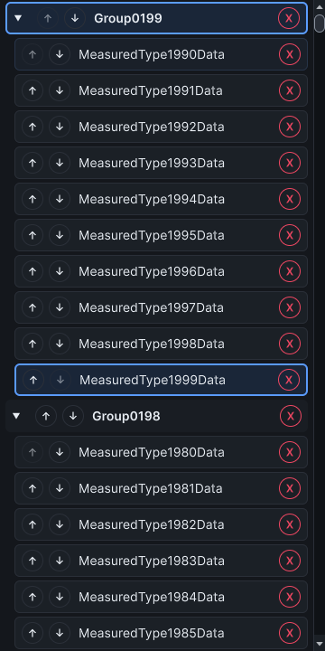

# Catalog keyboard entry and title hints

This bounded follow-up advances #312, #324 and the measurement evidence in #306. It does not complete those issues' wider acceptance.

## Behavior and regression coverage

After a filter hides the focused row, the catalog falls back to root focus. Previously, boundary and page keys only handled events on realized rows, so a remapped End key could not
enter the populated catalog after the filter cleared. Root focus now shares row boundary/page navigation. Hosted coverage checks an empty filter, remapped and disabled keys,
viewport-sized page entry, selection preservation, recycled rows, both 2k-type distributions and both persistence stores. The original renderer fails the root-entry regression.

Unity's elision handling can replace an assigned type-identity tooltip with only the displayed text. Catalog titles now keep explicit hints: normal names show the exact type name;
custom names show both the complete display title and exact type name. Hosted coverage checks localized custom text after layout and current tooltip identity after recycling. The
combined title/identity assertion fails before disabling automatic elision hints. Button hints and namespace identities retain their existing behavior.

## Paired synthetic observations

The unchanged `CatalogLayoutScaleTests.ShouldMeasureLargeCatalogConstructionAndScrolling` driver retains five warm-ups and 30 measured samples for 100/1k/2k CLR types, with one
namespace or ten types per namespace. Each report has all 180 observations. These are synthetic CLR identities, not real Unity assets. The existing driver verifies compiler source
checksums and loaded modules before and after sampling, plus native-window cleanup. Its ten-minute timeout and 512 MiB retained-heap growth guard remain unchanged.

| Types / distribution   | Binding p95 baseline → final (ms) | Observed scroll p95 baseline → final (ms) |
| ---------------------- | --------------------------------- | ----------------------------------------- |
| 1k / one namespace     | 3.1019 → 2.8627                   | 50.2681 → 38.2617                         |
| 1k / ten per namespace | 2.8612 → 2.2938                   | 49.1749 → 40.0529                         |
| 2k / one namespace     | 2.6625 → 2.4561                   | 47.5365 → 40.6187                         |
| 2k / ten per namespace | 3.2001 → 2.5152                   | 48.8729 → 44.8963                         |

Binding and later observed layout are separate clocks. Raw reports retain synchronous scroll calls and construction costs too. Every virtualized scroll binds 18 rows and realizes
at most 20. The per-thread allocation positive control is unsupported; values remain `-1`. Whole-editor frame allocation does not isolate this change. Lower final observations are
sequential warm-process measurements, not a controlled causal speedup, end-to-end keyboard latency, zero-allocation claim or whole-editor frame budget.

[Baseline samples](catalog-entry-baseline-2026-10-25.json) use the renderer from main `6c7cbc3`, SHA-256 `3d1e6601d8bf7611ff61b43bf294225d8bb6e54b658939bc07764fc83a3e3bd0`.
[Final samples](catalog-entry-final-2026-10-25.json) use renderer SHA-256 `3babb13e8fe0b341a69ca5466da146c4604ae6235fd9c43717f4bd3d8b1c095e`. Both use unchanged driver SHA-256
`1eb84d16d94cbb6e89a91aee0b3206bea0d6b764b9ba953d64100218538a5ff8`. Reports retain assembly hashes and module IDs. An earlier navigation-probe attempt correctly rejected stale
test-driver source; its output is excluded. The navigation probe passes after recompilation and verifies the changed test-driver and renderer sources.

The capture shows layout, not an operating-system tooltip or physical-keyboard task study. Both paired runs use Unity 6000.5.2f1 on Windows 11 build 26200, Snapdragon X Elite, dark
editor skin and one point per pixel. The driver captures six shipped themes; this report retains Dx. Light-editor and Unity 2021.3 execution, physical task time/error comparisons,
representative real-project/native-memory scaling and #306's full fixture, Play/compile and fresh-process matrices remain open. No wider acceptance box is promoted.
