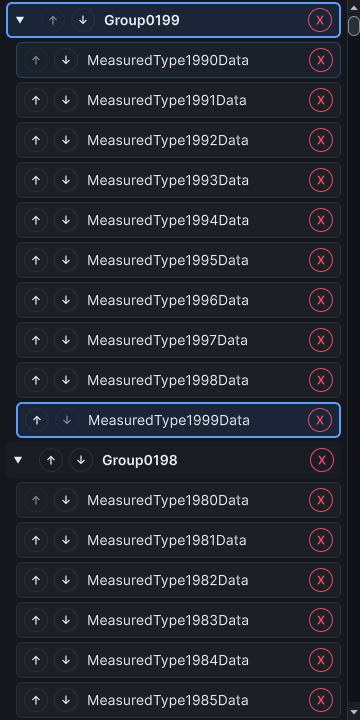

# Catalog filter and collapse observations, 25 October 2026

The existing hosted catalog driver now records filtering, clearing the filter and keyboard namespace collapse/expand separately. The
[baseline report](catalog-interactions-before-2026-10-25.json) and [final report](catalog-interactions-after-2026-10-25.json) each complete all 180 observations in one warm Unity
6000.5.2f1 Windows process, with the dark editor skin and one pixel per point. Inputs are synthetic CLR identities, not Unity assets or imported scripts.

## Method

Each size/distribution has five discarded warm-ups and 30 recorded repetitions. Sizes are 100, 1,000 and 2,000 types, grouped into one namespace or ten types per namespace.
Construction, scrolling and selection retain their existing clocks and row counts. The new phases apply only to the virtualized 1k/2k catalogs; compact 100-type observations retain
-1 sentinels for those fields.

After selection observations, the driver filters to the final exact type name and asserts two logical rows. It clears the filter, scrolls to the first namespace header, and sends
the configured collapse/expand keys. It verifies exact logical row counts after each transition and restores the expanded catalog. Call clocks stop after production returns;
observed clocks include a later editor update and layout settling. These are scripted component observations, not physical input or GPU presentation latency.

The unchanged ten-minute watchdog and 512 MiB additional retained-managed-heap guard remain in effect. The baseline NUnit case passes in 86.01 seconds; report elapsed time is 83.53
seconds. Native editor hosts and window wrappers return to their starting counts. Compiler source checksums and loaded module identities are verified before and after the run and
retained in the raw report. The driver source SHA-256 is `5b6cf15ff17b502efcd92f49d746c26a01299aca0d39f163369edf471cc03a2c`.

## Before and after

The final renderer reuses row controls when filtering or collapsing, projects the reconciled catalog order instead of sorting it again, and skips display-name lookup when no filter
is active. Header removal availability stops after finding the two removable types needed to show the command. Explicit namespace removal still gathers every target.

Percentiles use nearest rank, `ceil(0.95 × 30)`. Each cell is baseline → final call p95 in milliseconds.

| Types | Distribution            | Filter            | Clear filter      | Collapse         | Expand            |
| ----- | ----------------------- | ----------------- | ----------------- | ---------------- | ----------------- |
| 1,000 | One namespace           | 17.2577 → 9.9197  | 32.7917 → 8.0848  | 19.0132 → 6.8798 | 32.1549 → 11.0684 |
| 1,000 | Ten types per namespace | 13.5991 → 9.9629  | 25.6419 → 8.7550  | 29.5535 → 8.0298 | 26.1079 → 9.3140  |
| 2,000 | One namespace           | 25.2921 → 16.2922 | 35.5859 → 9.5750  | 19.6298 → 6.4888 | 35.8599 → 10.6619 |
| 2,000 | Ten types per namespace | 19.1873 → 15.7203 | 28.5570 → 10.8503 | 32.9146 → 9.5268 | 29.3555 → 9.3669  |

Final observed p95 (through the later editor update and settled layout) is separate from call p95:

| Types | Distribution            | Filter  | Clear filter | Collapse | Expand  |
| ----- | ----------------------- | ------- | ------------ | -------- | ------- |
| 1,000 | One namespace           | 34.8680 | 43.7314      | 16.9715  | 52.3094 |
| 1,000 | Ten types per namespace | 32.3085 | 43.0734      | 39.1516  | 50.0166 |
| 2,000 | One namespace           | 39.4025 | 45.8084      | 17.1527  | 55.9525 |
| 2,000 | Ten types per namespace | 39.0218 | 45.8860      | 39.9520  | 49.2553 |

The final case passes in 71.83 seconds; its report clock is 69.73 seconds. Both final source checks and native cleanup pass. The unchanged driver checksum above binds both runs.
Final renderer SHA-256: `45b7a4b98ba1ecb0bfee694a1c09b2483508ae42feef9aaf1b46523a2d6931e5`.

The hosted regression fails on the baseline because filtering creates 14 replacement controls. It passes after the repair with no new controls during filled-viewport filtering and
clearing. It also verifies that filtering releases pointer capture and a stale pointer-up cannot select a recycled identity. Existing grouping, collapse, exact identity, ordering,
focus, persistence and six-theme assertions remain in place. These checks establish row reuse for this scenario, not zero allocation.

The [intermediate report](catalog-interactions-intermediate-2026-10-25.json) predates the bounded removable-type scan. It completed successfully but has a different renderer
checksum; it is excluded from the final comparison. All reports preserve their original bytes. The final capture comes from the completed final run. Sequential warm-process
measurements do not establish a controlled speedup or a whole-editor frame bound. Filter p95 remains 9.92–16.29 ms at 1k/2k, and the 4 ms target is not met.

## Limits

The rooted allocation control reports zero observed bytes for a 4 KiB allocation, so the per-thread allocation counter is unsupported. Whole-editor frame allocation, process heap
and Unity allocation fields do not isolate these interactions. Dynamic types remain loaded in the process. This is neither a fresh-process comparison nor a real-project, Unity
2021.3 or cross-platform matrix. The new phases do not measure catalog text-field event routing, user task time/errors or asset-change reconciliation.

Issues #306 and #324 remain open for their broader fixture/distribution/lifecycle, allocation, layout and platform acceptance. No support guarantee or release is added.
