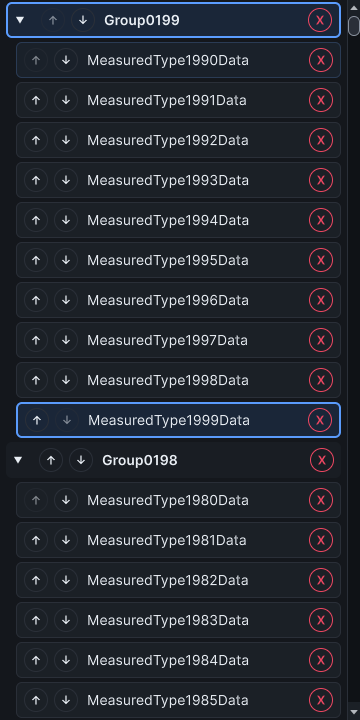

# Catalog scroll binding observations, 25 October 2026

The [baseline report](catalog-scroll-before-2026-10-25.json) and [final report](catalog-scroll-after-2026-10-25.json) each complete all 180 observations in one warm Unity
6000.5.2f1 Windows process, dark editor skin, one pixel per point. Inputs are synthetic CLR identities, not Unity assets or imported scripts. Five warm-ups and 30 measured
repetitions cover 100, 1,000 and 2,000 types in one namespace or ten types per namespace. The unchanged ten-minute watchdog and 512 MiB additional retained-managed-heap guard
apply.

The existing driver now separates three scroll clocks: the scroll-offset setter call, accumulated production row-binding time, and the later settled-layout observation. Binding can
occur after the setter returns. The binding wrapper adds two timestamp reads per call. Installing it can itself rebind rows; a later layout settles before counters reset. Compact
100-type catalogs retain -1 binding sentinels. Every measured virtualized scroll moves, binds new identities and realizes type rows intersecting the viewport. Counters stop before
restoring the original binding delegate.

Nearest-rank p95 uses `ceil(0.95 × 30)`. All timings are milliseconds. Cells show baseline → final; both runs bind 18 rows per measured virtualized scroll.

| Types | Distribution            | Scroll call     | Binding          | Later layout        |
| ----- | ----------------------- | --------------- | ---------------- | ------------------- |
| 1,000 | One namespace           | 1.1479 → 0.6939 | 9.7232 → 5.9621  | 51.5671 → 129.8785  |
| 1,000 | Ten types per namespace | 1.0120 → 0.6673 | 10.3397 → 5.8133 | 68.4201 → 130.1487  |
| 2,000 | One namespace           | 1.8262 → 0.8412 | 11.8037 → 6.2242 | 69.4059 → 128.9874  |
| 2,000 | Ten types per namespace | 1.1580 → 0.7269 | 27.5404 → 5.3107 | 114.5784 → 126.8020 |

Baseline NUnit passes in 117.93 seconds; the report clock is 113.56 seconds. Final NUnit passes in 81.33 seconds, with a 78.68-second report clock. Compiler source checks and
loaded module identities are verified before and after the run; native hosts and window wrappers return to their initial counts. The report preserves the original emitted bytes,
checksums and module identities. The baseline includes the captured-row gesture repair; it still scans canonical siblings to decide whether ordering buttons are enabled. The final
renderer reads canonical first/last identities directly, without new scratch storage.

The unchanged driver source SHA-256 is `1eb84d16d94cbb6e89a91aee0b3206bea0d6b764b9ba953d64100218538a5ff8`. Final renderer SHA-256 is
`6b9b8ca03c355646ccbc67aa51781df527dc25662e989d33e3eab606755978f8`. The hosted regression covers filtered ordering controls after an earlier canonical reorder, both persistence
stores, capture cancellation, recycled focus, collapse and all six shipped themes. Its initial new boundary assertion overlooked the fixture's earlier reorder; that setup failure
is excluded from production evidence.

These runs are sequential warm-process observations, not a controlled comparison. Binding p95 improves in the retained samples, but later-layout p95 worsens. Scheduling/layout
variance remains material, and the result does not establish an end-to-end scrolling speedup or a hard 4 ms budget.

The rooted 4 KiB allocation control reports zero, so per-thread allocation is unsupported. Whole-editor frame allocation and process/native heap fields do not isolate scrolling.
These scripted warm-process component observations do not establish physical input latency, GPU presentation, zero allocation, a 4 ms editor-frame bound, a usability study, Unity
2021.3 execution or a real-project/platform matrix. Issues #306, #312 and #324 retain their broader acceptance criteria.
