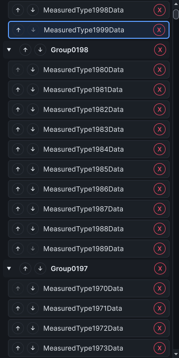

# Catalog selection observations, 24 October 2026

Selecting another type in an expanded virtualized catalog now changes the realized rows' selection styling without rebuilding their content. Collapsed namespaces still expand when
revealed. Keyboard selection still reveals and focuses the exact destination type; refreshing selection preserves action-button focus and restores ordering-button availability
after pause/resume. This advances #324 and #312. The observer separates selection from catalog construction and scrolling for #306.

## Method and source identity

The [before](catalog-selection-before-2026-10-24.json) and [after](catalog-selection-after-2026-10-24.json) reports each contain all 180 observations over 100/1k/2k synthetic types
and two namespace distributions. Each condition discards five warm-ups, then records 30 samples. The 100-type conditions use compact rendering and omit selection measurements
(`-1`); each report contains 120 virtualized selection observations. No Unity assets are generated, discovered or loaded for these synthetic catalog inputs.

Both runs use the same observer source SHA-256 `4a497277a2b476ae679142c5c34fc286505b436833417735a75a6d70f3c88d98`. The renderer source changes from
`a9c804a5419db24cf711ec27c466a2f8059add9454dec4fae07709edafd2da6d` to `aa6bc0f29310b8e2013df1a85b36af9fdd95e3b317230e2796caa0d2f4cdc8f8`; the baseline renderer is the main-branch
source at `0cc2f8e`. Each run verifies source bytes against compiler PDB checksums and loaded modules against disk assemblies before and after measurement. Exact
source/module/assembly identities are in the raw reports. The catalog controller source is unchanged. Final code is `16e457e`. The test source is frozen during final validation.

The observer creates fresh catalogs from prefixes of 4,000 generated plain CLR types, with one namespace or ten types per namespace. It uses the actual 360 × 720 popup and its
inner ListView viewport. After the existing construction and bottom-scroll observation, selection reveals the penultimate generated type. The observer installs row callbacks,
settles layout, and resets their counters before timing selection of the final generated type. It snapshots counters before restoring the callbacks. This measures an adjacent,
already-visible selection; it does not measure offscreen navigation or object-pane loading.

Both runs complete under the unchanged ten-minute watchdog and 512 MiB additional retained-managed-heap guard. They verify native editor hosts and EditorWindow wrappers return to
their starting counts. The before/after report clocks are 57.344/69.652 seconds. These are sequential runs in one warm Unity 6000.5.2f1 Windows process, with the dark editor skin
and one pixel per point. Dynamic types remain loaded. Scheduling, loaded types and process memory differ between runs; there is no fresh-process, randomized or isolated-memory
control.

## Results

Percentiles use nearest rank, `ceil(0.95 × 30)`. The synchronous call clock stops when production selection returns. The observed clock also includes a later editor update and
layout settling; it is not physical input latency or GPU presentation.

| Types | Distribution            | Before call p95 (ms) | After call p95 (ms) | Before observed p95 (ms) | After observed p95 (ms) | Created rows per sample | Content binds per sample |
| ----- | ----------------------- | -------------------- | ------------------- | ------------------------ | ----------------------- | ----------------------- | ------------------------ |
| 1,000 | one-large-namespace     | 24.7490              | 1.5422              | 54.7809                  | 31.8657                 | 20 → 0                  | 18 → 0                   |
| 1,000 | ten-types-per-namespace | 25.3052              | 1.4079              | 56.4232                  | 25.9435                 | 20 → 0                  | 20 → 0                   |
| 2,000 | one-large-namespace     | 30.1653              | 1.7984              | 61.3536                  | 38.7869                 | 20 → 0                  | 18 → 0                   |
| 2,000 | ten-types-per-namespace | 31.6458              | 1.1228              | 65.7753                  | 26.4372                 | 20 → 0                  | 20 → 0                   |

Each before sample creates 20 rows; after samples create and bind zero rows during the measured transition. This establishes removal of the observed row churn, not zero allocation
or a whole-editor frame guarantee. The rooted allocation control remains unsupported (`constructionAllocatedBytes=-1`); whole-editor frame allocation and process heap fields do not
isolate selection allocation. Construction and scrolling remain separate raw observations and are not the claimed effect of this change.

The capture comes from the repaired run after timed observations. It uses synthetic names in a themed popup, not a real project's full browser. The hosted regression separately
exercises long localized labels and all six shipped themes, both persistence stores, collapsed reveal, exact identities with equal short names, recycled keyboard focus, stable
action focus and unchanged refresh scroll. Automated checks do not replace the exploratory usability study.

## Excluded observations and validation

The [excluded first observer run](catalog-selection-excluded-2026-10-24.json) completed its original method checks. Its row counters include callback installation and restoration:
assigning ListView delegates itself rebuilds/rebinds rows. Do not use its counters or timings in the comparison above. The corrected observer resets after installation and
snapshots before restoration. The excluded report retains its original bytes and completion flag.

The [validation record](catalog-selection-validation-2026-10-24.json) retains the original row-identity regression failure, the later instrumentation failure, the passing hosted
regression and both accepted observer results. The original failure occurs before the content-bind assertion: selecting an adjacent type replaces all 14 realized rows. The repaired
hosted case passes without weakening row-identity, binding, focus or selection assertions. A temporary scroll-visibility helper was removed after the trace identified observer
setup as the binding source; it is absent from the final code. The new availability test invokes the public window lifecycle callback; it is not actual Play entry or a
domain-reload matrix.

The initial code passed 885/885 EditMode cases before review exposed disabled ordering buttons after a pause/resume callback. A focused regression reproduces that failure, then
passes with per-row boundary flags and direct availability updates. The [intermediate measurement](catalog-selection-intermediate-2026-10-24.json) predates this repair and is not
the final comparison. Its source hash differs; preserve it as intermediate evidence.

Final validation on `16e457e` passes 885/885 EditMode cases in 733.48 seconds and 15/15 actual PlayMode cases in 0.42 seconds, including the runtime mode assertion. Unity returns
to EditMode. The loaded renderer module and assembly still match the final experiment after both suites. The local gate passes all 16 checks; the exact package audit contains 267
allowed tracked files with matching source bytes. Test reports and captures ship in neither the package nor the public documentation site.

The broader #312 exploratory add/find/clone/rename/move/delete study, light editor skin, Unity 2021.3 execution, representative project/platform checks, selected-object retention
and #306's asset/distribution/lifecycle matrices remain open. These observations do not complete those issues or expand support. No release is published.
