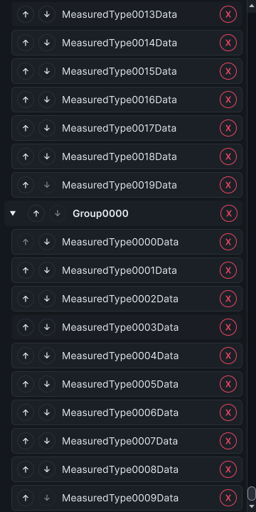
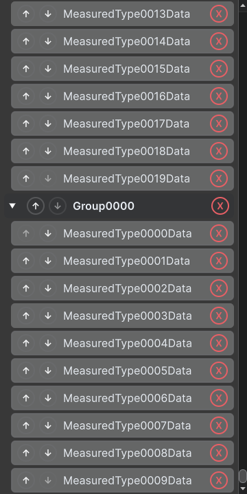
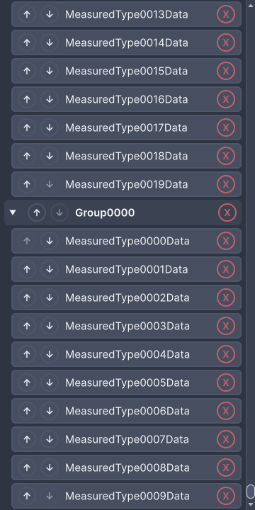
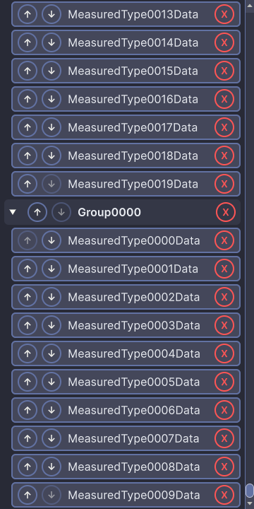
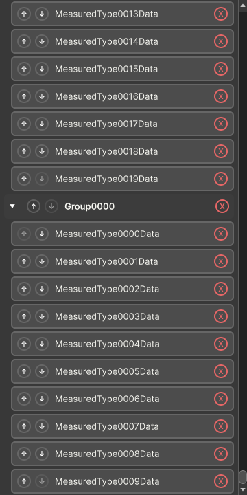
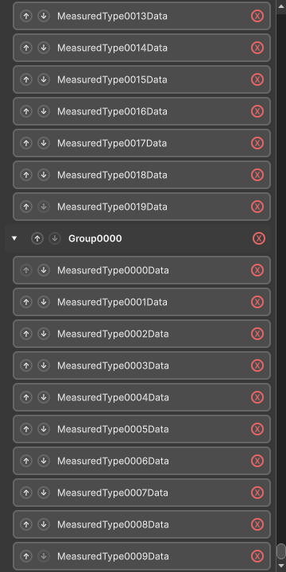

# Virtualized catalog observations, 24 October 2026

The measured C# tree is `1d05aae` on Unity 6000.5.2f1 Windows, in one warm editor process with the dark editor skin and one pixel per point. This is synthetic catalog work, not
asset discovery, whole-window readiness, native-memory scaling or real-project support. [Provenance](catalog-virtualization-provenance-2026-10-24.json) binds six loaded surfaces to
compiler source checksums and assembly bytes before and after measurement. Later evidence commits do not change C#.

## Complete popup experiment

The [raw report](catalog-virtualized-2026-10-24.json) retains all 180 observations: five discarded warm-ups and 30 samples for each size/distribution. The
[NUnit result](catalog-virtualized-nunit-2026-10-24.json) passes. Report elapsed time is 26.041 seconds; the test completes in 27.86 seconds. The original ten-minute watchdog and
512 MiB additional retained-managed-heap guard stay intact. Native editor hosts and window wrappers return to their starting counts.

Inputs are the same prefixes of 4,000 generated plain CLR identities used by the
[historical catalog experiment](catalog-and-browsing-2026-10-24.md#catalog-construction-and-scrolling). They are not ScriptableObjects or imported scripts. No Unity asset is
created or instantiated. These CLR types remain loaded in the process. Each repetition creates a new controller and calls production `Build`; inputs include one large namespace and
ten types per namespace. The actual popup root is asserted at 360 × 720 points; the measured scroll viewport is 347 × 720 points. Scroll observations use the inner ListView
viewport when virtualized.

| Types | Distribution            | Construction p95 (ms) | Observed scroll p95 (ms) | Elements after initial layout | Realized type rows | Type rows intersecting viewport | Editor-frame allocation p95 (bytes) |
| ----- | ----------------------- | --------------------- | ------------------------ | ----------------------------- | ------------------ | ------------------------------- | ----------------------------------- |
| 100   | One namespace           | 20.6802               | 22.4966                  | 510                           | 100                | 17                              | 2,002,379                           |
| 100   | Ten types per namespace | 25.6539               | 25.6725                  | 591                           | 100                | 16                              | 2,232,957                           |
| 1,000 | One namespace           | 3.8540                | 35.1148                  | 165                           | 20                 | 18                              | 976,073                             |
| 1,000 | Ten types per namespace | 4.8571                | 36.9092                  | 165                           | 19                 | 17                              | 2,449,622                           |
| 2,000 | One namespace           | 6.7934                | 35.3199                  | 165                           | 20                 | 18                              | 1,184,575                           |
| 2,000 | Ten types per namespace | 8.0474                | 36.1404                  | 165                           | 19                 | 17                              | 1,244,365                           |

Percentiles use nearest rank, `ceil(0.95 × 30)`. Catalogs above 128 types use the flattened ListView; smaller catalogs keep the existing compact tree. The full logical list retains
all type identities and namespace headers. At both 1k and 2k, exactly 20 catalog rows and 165 elements exist in this viewport. Headers account for the difference between catalog
and type rows. Realized elements are counted again after scrolling; every measured scroll moves. Viewport intersection is not pixel visibility or GPU presentation.

Construction ends before attachment/layout. Scroll time includes subsequent editor updates, scheduling and settled-layout observation until a realized row intersects the viewport,
bounded by five seconds. It does not isolate input latency. The rooted 4 KiB allocation control still fails, so per-call construction allocation is unavailable (`-1`). The separate
ProfilerRecorder values observe a completed whole-editor frame, including unrelated editor and observer work. Heap and Unity allocation fields are process observations, not an
isolated allocation or native-retention slope.

The older report retains all 2,000 rows and 10,010–11,801 elements at 2k. That establishes the earlier unbounded construction. Its requested host size was 360 × 720, but it did not
retain or assert actual viewport dimensions. The runs also differ in source, warm-process state and editor scheduling. Do not turn their timing differences into a controlled
speedup or matched scrolling comparison.

## Excluded host-layout attempt

The [first raw report](catalog-forced-root-attempt-2026-10-24.json), at `134214c`, completed its samples and passed its method checks. Its capture forced root dimensions inside a
larger native utility host, compressing rendered content. It is excluded from the table and usable-layout evidence. The corrected driver uses the existing native popup capture path
and asserts actual root dimensions. Preserve the original report's `complete=true` as method completion, not proof of a valid capture.

## Layout and interaction evidence

Captures are taken after all timed samples, in the same 360 × 720 popup. They show synthetic type names and do not depict a real project's catalog.

| Dx                                          | Classic                                     | Nord                                        |
| ------------------------------------------- | ------------------------------------------- | ------------------------------------------- |
|            |  |        |
|  |  |  |

The hosted regression separately uses long localized display and namespace labels under all six themes. It checks row bounds, bounded realization, hidden/collapsed navigation,
recycled focus, pointer drag ordering, both persistence stores, reopening, equal short names with exact type identity, removed selections and transition back to the compact tree.
Review repairs use named catalog entries, configurable row bindings and drag distance, span-based filter terms, and direct realized-row scans. A remapped key, accented case
folding, drag boundaries and destroyed window owners have separate coverage. Unchanged catalog reconciliation preserves existing visual rows. A
[pre-fix failure](catalog-drop-idempotency-red-2026-10-24.json) and passing regression cover unchanged adjacent drops; they return false and do not save or rebuild the catalog.
Catalog action buttons have a separate pre-fix failure and passing pointer-propagation regression.

These are automated interactions and layout checks. They are not timed add/find/clone/rename/move/delete usability tasks. The light editor skin, Unity 2021.3 execution, other
platforms, fresh processes, real 100k assets, selected-object retention and the wider readiness/operation matrices remain unproven. Those requirements stay in #312, #306, #309 and
their owning issues. No release or support expansion is inferred.

The [interrupted review run](catalog-interrupted-review-run-2026-10-24.json) was canceled through Unity’s runner API for the destroyed-owner guard. Its cached MCP status remained
running after the native job and fixture driver stopped; it is not passing-suite evidence. Earlier complete 879-case suites precede the final review repairs.

The [validation runs](catalog-validation-runs-2026-10-24.json) retain the failed 881/885 suite and the excluded 66-sample observer attempt. The latter sampled after one editor
update before recycled rows intersected the viewport; the final observer waits with a five-second limit. Splitter fixtures now establish their required wide dock geometry, and the
theme fixture waits for its expected colors. These repairs do not change production layout or weaken the assertions.

The unchanged-selection scroll jump and compact-fallback filter loss were independently reproduced and repaired in `1d05aae`. The hosted regression now browses away from selection
in a scrollable catalog and verifies refresh preserves its offset; compact fallback retains filtering and updates the hidden-namespace count. The complete pre-repair suite passed
885/885 in 670.57 seconds, but does not cover those new assertions. Final-suite status is recorded in provenance.

Final validation on `1d05aae` passes 885/885 EditMode cases in 947 seconds and 15/15 actual PlayMode cases in 0.40 seconds. The six source/compiler/module identities still match
after both suites. The local gate passes all 16 checks; the exact package audit contains 267 allowed tracked files with matching source bytes. No merge or release is part of this
evidence.
