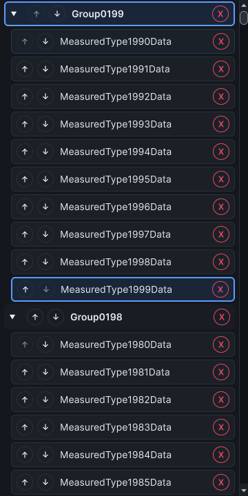

# Input configuration and browser interaction costs

These observations cover PRs #472–#474 for #312, #308 and #324. They do not complete those issues' broader acceptance.

## Configuration repair

Full JSON configuration passed the default `keep` input-profile sentinel to GUID validation. Preview succeeded, but apply returned `configuration_failed`, including read-only
requests. The original full suite reproduced both migration-direction failures and the wrong read-only error. The repaired configuration fixture passes 34 cases, including keep,
omitted, replacement and empty/default profile requests across both persistence modes. Non-configuration operations reject profile edits. Preview and repeat-apply semantics remain
covered.

## Duplicate refresh intake

The [unchanged probe](refresh-intake-probe-2026-10-25.cs.txt) uses synthetic tracked paths and GUIDs with an injected resolver. Each condition seeds one pending identity, measures
1,000 duplicate GUID notifications, then verifies one resolve and publication. Each tracked-count condition has five warm-ups and 30 retained samples. Scheduling stays enabled. The
service is disposed before returning. No Unity assets are created or loaded. This measures duplicate intake, not changed-row reconciliation or import callbacks.

| Tracked identities | Baseline median / p95 (ms) | Final median / p95 (ms) |
| ------------------ | -------------------------- | ----------------------- |
| 1,000              | 5.4613 / 5.8813            | 1.4969 / 2.4264         |
| 10,000             | 5.4870 / 5.9168            | 1.4474 / 1.7848         |
| 100,000            | 5.5511 / 6.6624            | 1.3813 / 1.7560         |

Times cover 1,000 calls, not one call. The baseline is source `8886db38028f769327e7cb09e6238b9720f35024a4418148e543a6cc3285bbdc`; final service source is
`ab9deb178b4ca34594f424d3df7bd1bb1e8e6cc502cb0ea4e2aca78acdde1dae` (commit `988e472`). Reports retain loaded module IDs; compiler/source/module verification runs before and after
sampling. Probe SHA-256: `0029afb469b897cf41b5d3275c8259464a00e828d274d0a119f697add8e38f19`.

[Baseline samples](refresh-intake-baseline-2026-10-25.json) and [final samples](refresh-intake-final-2026-10-25.json) retain all 90 observations each. Production now queues a
single path without a temporary array and skips scheduler transitions when no work is added. Eighteen refresh-service cases pass, including mixed entry-point coalescing, real
move/delete identity, missing scripts, suspension and disposal. No per-call allocation counter was measured. These sequential warm-session results do not establish real 100k-asset
support, whole-window latency, a hard frame bound or zero allocation.

## Catalog hints

The existing `CatalogLayoutScaleTests.ShouldMeasureLargeCatalogConstructionAndScrolling` driver is unchanged. Each run retains 180 observations: 100/1k/2k synthetic CLR types, one
namespace or ten types per namespace, five warm-ups and 30 samples per condition. No real catalog assets are created. Binding now leaves collapse/order/remove hint formatting until
`TooltipEvent`; it reads the current realized title and bindings, with no logical-entry cache. Recycled-row action hints and dynamic collapse bindings pass hosted coverage.

| Types / distribution   | Binding p95 baseline → final (ms) | Observed scroll p95 baseline → final (ms) |
| ---------------------- | --------------------------------- | ----------------------------------------- |
| 1k / one namespace     | 4.5116 → 4.4894                   | 45.3851 → 82.8999                         |
| 1k / ten per namespace | 4.6935 → 4.6118                   | 50.2261 → 45.8796                         |
| 2k / one namespace     | 4.5222 → 3.2728                   | 44.9578 → 41.2997                         |
| 2k / ten per namespace | 4.7718 → 6.5089                   | 52.5899 → 66.5171                         |

The results are mixed. At 2k with many namespaces, both binding and later observation worsen. There is no uniform or end-to-end speedup claim. Observed scroll includes later editor
work and yields. Raw reports also retain synchronous call clocks. Every virtualized scroll binds 18 rows and realizes at most 20. The per-thread allocation control is unsupported,
so unavailable values remain `-1`; whole-editor frame allocation includes unrelated work and does not isolate hint formatting.

[Baseline](catalog-hints-baseline-2026-10-25.json) and [final](catalog-hints-final-2026-10-25.json) are complete and verify native cleanup. Both use driver source
`1eb84d16d94cbb6e89a91aee0b3206bea0d6b764b9ba953d64100218538a5ff8`. Renderer hashes are `42afb2d46015b832f3d92b145a404e055a1b0eb4319a026516e8570527d73b1d` before and
`3d1e6601d8bf7611ff61b43bf294225d8bb6e54b658939bc07764fc83a3e3bd0` after (commit `00f28ef`). The final tree also includes the unrelated refresh-intake repair; these are sequential
component observations, not an isolated whole-editor A/B experiment.

The capture shows final synthetic row layout, not a painted tooltip or physical-input study. Both runs use Unity 6000.5.2f1, Windows 11 build 26200, dark editor skin and 1 point
per pixel in one warm process. The driver captures six shipped themes; only the Dx capture is retained here. Light editor skin, Unity 2021.3 execution, physical task times/errors,
representative real-project scaling and the wider lifecycle/platform matrices remain open in the owning issues.
