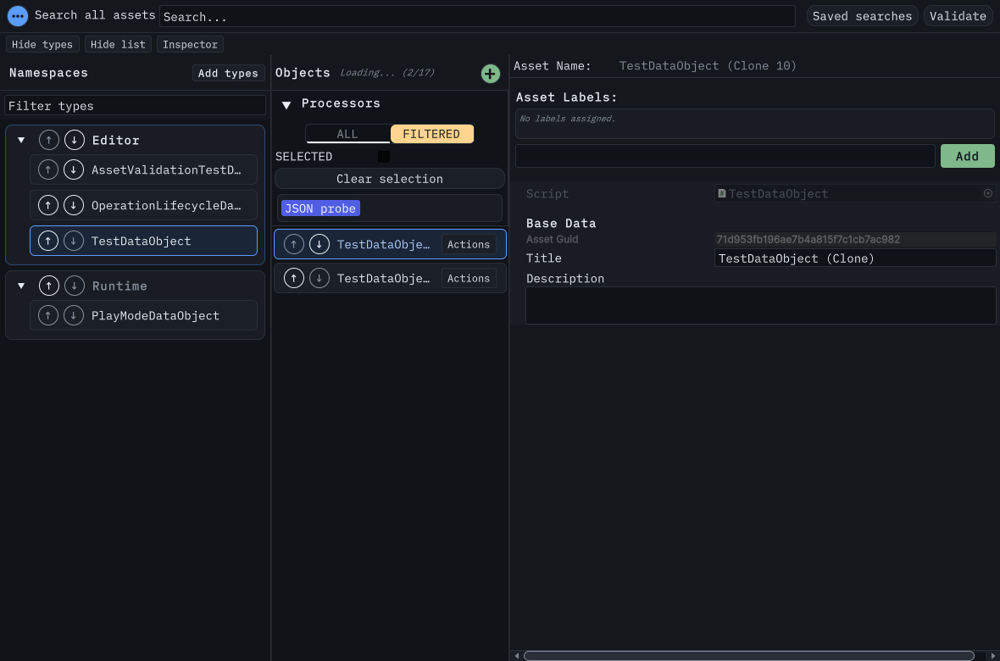

# Processor control keyboard coverage, 26 October 2026

Unity 6000.5.2f1, Windows editor, native dark skin. The production window uses isolated user/project state and the existing JSON probe processor. No processor is executed by the
capture.

The capture shows the normal 1180-point window with the actual ALL choice focused while FILTERED remains selected. Its underline identifies focus without changing scope. Asset
loading is still in progress; this image is not loading-performance evidence.

`PlayModeMutationGateTests.ShouldChooseProcessorScopeWithOwnerInput` reproduces two failures on their original implementations: the scope labels are not focusable, and the section
arrow is not a focusable button. The repaired hosted test passes both persistence stores, Tab entry, Return/Space, remapped/unbound keys, profile replacement, exact scope
modifiers, remapped completed clicks, outside-release cancellation, selection-key precedence over Rename, SELECTED scope, live hints, section collapse/reopen and the paused
execution guard. It checks compact geometry and visible focus across all six package themes. The 23-case mutation suite and 19-case label-filter suite also pass before the
section-button extension; aggregate validation is recorded in commits and linked issues.

These are scripted event and layout checks. They do not replace physical-keyboard testing, a human task-time/error study, Unity 2021.3 execution or wider operating-system evidence.
Broad acceptance in #312 remains open. The test owns and removes one fixture asset and closes its native window; the capture restores host preferences and uses disposable state.
