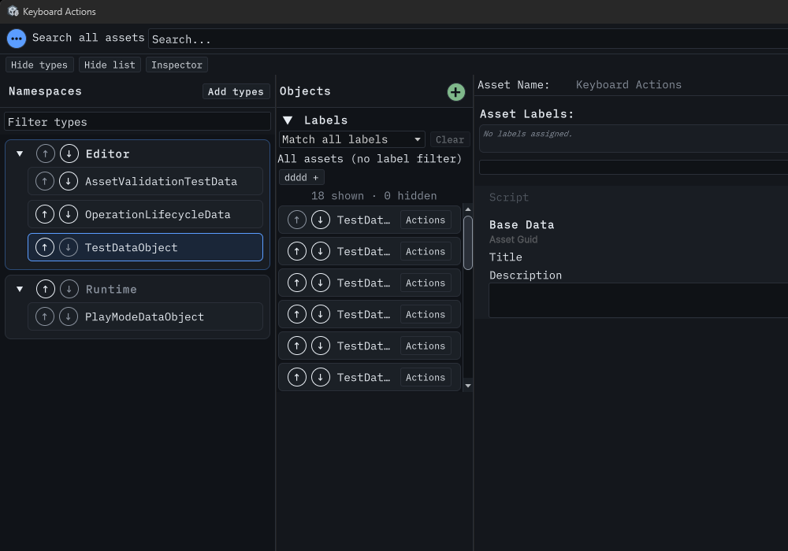

# Selected-asset keyboard Actions

Issue #312. Hosted exploratory probes on Unity 6000.5.2f1, Windows 11, dark editor skin. This is scripted event routing, not a timed usability study or physical-keyboard/platform
coverage.

The loaded editor assembly's compiler checksum matches DataVisualizer.cs SHA-256 `6333e9279edb26a2ff0d78564bb77b277b4632b287ba4c624a8c305cfc09384a`. A uniquely owned TestDataObject
asset was selected through the real ListView. Shift+F10 was handled and preserved the selected asset. The list was then shortened to 240 points and scrolled to the top. A query
found zero realized rows for the selected asset. The Menu key was handled and preserved the same selection. The shared Actions menu and existing command handlers serve both paths.

The capture shows the offscreen-selection scenario, not the native menu itself. The bridge timed out after the native-menu probe and later recovered; no menu-paint claim is made.
Initial probes targeted the containing column rather than the focused list and lost selection during startup; those unhandled events are excluded. Cleanup independently reported
zero probe windows and zero owned fixture roots.

Keep #312 open for timed add/find/clone/rename/move/delete comparisons, light-editor usability, localized layouts and remaining compatibility acceptance.
